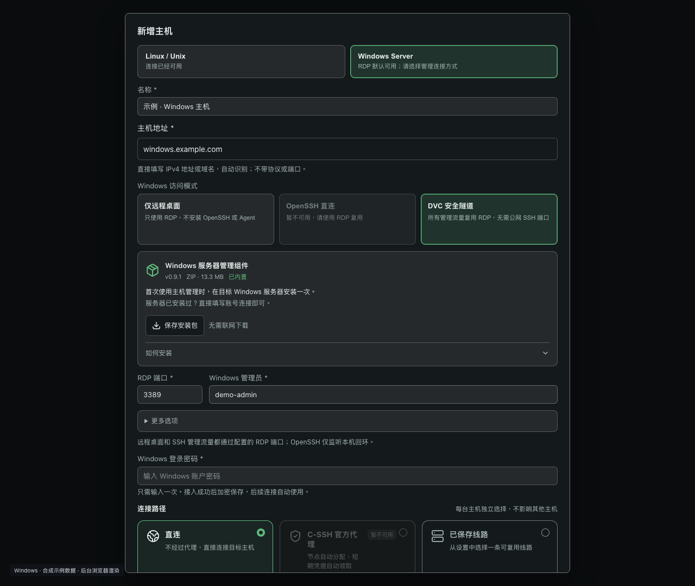
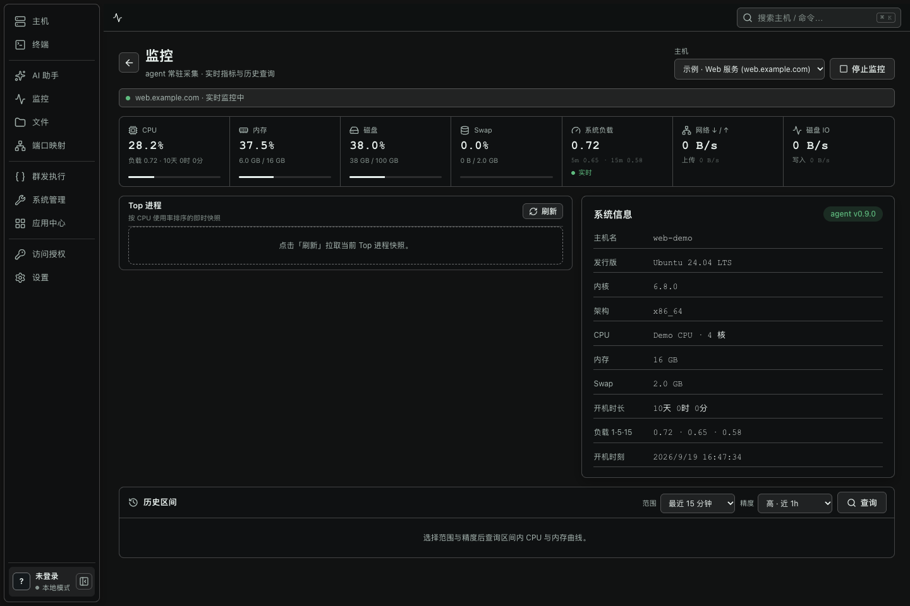

[中文](README.md) | **English**

# C-SSH 0.9.4

A server-operations workspace for **Windows, Apple Silicon Mac, Android and Linux**: hosts, persistent terminals, RDP, monitoring, files and scoped AI. Local features work without a Cloud login.

> **0.9.4 is announced through notices only. Download and install manually; no upgrade prompt or forced update is sent.**
>
> Android keeps the 0.9.0 signer and can replace 0.9.0 and 0.9.1. Earlier official builds with a different signer cannot be replaced directly. Uninstalling clears local data. Read the [installation and data-preservation guide](INSTALL_EN.md), especially the note that AI conversations and memory are not included in Cloud sync. The Mac DMG is Apple Silicon only, ad-hoc signed and not notarized.

## Downloads

| File | Bytes | Download |
|---|---:|---|
| C-SSH_0.9.4_android-arm64.apk | 39,707,218 | [Download](https://github.com/suiyuebaobao/C-SSH/releases/download/v0.9.4/C-SSH_0.9.4_android-arm64.apk) |
| C-SSH_0.9.4_aarch64.AppImage | 116,402,696 | [Download](https://github.com/suiyuebaobao/C-SSH/releases/download/v0.9.4/C-SSH_0.9.4_aarch64.AppImage) |
| C-SSH_0.9.4_amd64.AppImage | 117,410,296 | [Download](https://github.com/suiyuebaobao/C-SSH/releases/download/v0.9.4/C-SSH_0.9.4_amd64.AppImage) |
| C-SSH_0.9.4_amd64.deb | 43,882,432 | [Download](https://github.com/suiyuebaobao/C-SSH/releases/download/v0.9.4/C-SSH_0.9.4_amd64.deb) |
| C-SSH_0.9.4_arm64.deb | 43,049,976 | [Download](https://github.com/suiyuebaobao/C-SSH/releases/download/v0.9.4/C-SSH_0.9.4_arm64.deb) |
| C-SSH_0.9.4_macOS-arm64.dmg | 42,342,556 | [Download](https://github.com/suiyuebaobao/C-SSH/releases/download/v0.9.4/C-SSH_0.9.4_macOS-arm64.dmg) |
| C-SSH_0.9.4_arm64-setup.exe | 45,720,976 | [Download](https://github.com/suiyuebaobao/C-SSH/releases/download/v0.9.4/C-SSH_0.9.4_arm64-setup.exe) |
| C-SSH_0.9.4_portable-Windows-arm64.zip | 41,482,505 | [Download](https://github.com/suiyuebaobao/C-SSH/releases/download/v0.9.4/C-SSH_0.9.4_portable-Windows-arm64.zip) |
| C-SSH_0.9.4_portable-Windows-x64.zip | 42,794,746 | [Download](https://github.com/suiyuebaobao/C-SSH/releases/download/v0.9.4/C-SSH_0.9.4_portable-Windows-x64.zip) |
| C-SSH_0.9.4_x64-setup.exe | 47,565,127 | [Download](https://github.com/suiyuebaobao/C-SSH/releases/download/v0.9.4/C-SSH_0.9.4_x64-setup.exe) |

[Installation and data preservation](INSTALL_EN.md) · [Website](https://c-ssh.com/en) · [Release](https://github.com/suiyuebaobao/C-SSH/releases/tag/v0.9.4)

0.9.4 uses announcements and manual downloads only, with no upgrade prompt or forced update. Mac is Apple Silicon arm64 only, minimum target macOS13, ad-hoc signed and not notarized. Windows installers have no Authenticode signature. Android retains the release signer used since 0.9.0; earlier differently signed builds cannot be replaced directly. AI content is excluded from Cloud sync; read the installation and data-preservation guide first.

## What changed

### Added

- **Bulk host import**: Import CSV or OpenSSH configuration, preview and select entries, then create pending connections. A host becomes active only after credentials are supplied and real authentication succeeds. Previewing is not connecting; passwords and private keys are not stored in the plaintext pending queue.
- **Skippable first-use guide**: Discover connection, import and operations entry points, or skip directly to the workspace. The choice survives a cold restart and the guide can be reopened in Settings. Upgrades with existing data do not force onboarding.
- **Automatic AI operations Skills**: Experience is learned only after tools execute and acceptance succeeds. Later tasks reuse it only when the current environment matches. No manual save or adoption step is required; the normal UI shows a single light notice when past experience is referenced. Existing permissions and confirmations still apply. Skills, AI conversations, raw records and long-term memory remain local and are excluded from Cloud sync.
- **Readable operation-log rows**: One business operation per row, with time, level, local host name and a trustworthy result. Collection is off by default; enable and query it as needed, switch to the technical view or export support material. A successful substep or transfer never implies that the whole operation succeeded; unknown and incomplete outcomes are explicit.
- **Version and data upgrade**: Four platforms ship 0.9.4 with client SQLite schema 22. iOS is maintained at 0.9.4/9004000 but no iOS artifact is uploaded.

### Fixed

- **Frost-white theme readability**: Corrected primary-button backgrounds, text, hover, disabled and keyboard-focus states on Windows, Mac and Linux.
- **Android fresh-install startup**: Corrected the earlier 0.9.4 candidate that was incorrectly rejected during cold startup. The new formal APK passed a fresh arm64 Android SDK Emulator cold start and normal UI checks, retaining the original release signer. The earlier candidate's failed result is preserved.

## Capabilities

| Area | Features |
|---|---|
| Hosts and projects | Create, edit, search, favorite, group; IPv4/domains, separate ports, passwords/keys and explicit proxy routes |
| SSH and Agent | Choose standard SSH or Agent per host, with shared identity, capability and error handling |
| Terminals | Linux tmux, Windows Terminal2/psmux and standard SSH; desktop tabs and mobile input/session recovery |
| Windows RDP | Remote desktops and DVC management within RDP, with certificate/account verification and a real-logon gate |
| Monitoring | CPU, memory, disk, load, network/disk IO, live/history charts, top processes and collection settings |
| Files | Browse, upload, download, create, rename, delete, edit text and verify hashes; native mobile file pickers |
| AI | Global/project/host scope, model accounts/bindings, permissions, confirmations, stop, history and local memory |
| System and apps | System information, processes, firewall and services; desktop Docker/systemd/Windows-service tools depend on server capabilities |
| Desktop tools | Windows/Mac/Linux port forwarding, saved commands, broadcasts, per-host results and access grants |
| Proxies | Direct, saved SOCKS5/HTTP CONNECT and explicitly selected official routes; no silent direct fallback |
| Cloud | Optional login, devices, explicit encrypted host/proxy/model-account sync and self-hosted service selection |
| Preferences | Nine languages, appearance, collection and data protection; diagnostic logging is off by default |

[Detailed features and platform differences](FEATURES_EN.md) · [Self-hosted Cloud](SELF_HOSTING_EN.md) · [Screenshot gallery](screenshots/README_EN.md)

## Screenshots

The retained 0.9.0 gallery was published on 2026-09-29; the 0.9.1 additions on 2026-09-30. These are historical UI examples with synthetic data, not new 0.9.4 screenshots.

[Windows](screenshots/WINDOWS_EN.md) · [Mac](screenshots/MACOS_EN.md) · [Android](screenshots/ANDROID_EN.md)

The [new 0.9.1 form](screenshots/v0.9.1/README_EN.md) and retained 0.9.0 full gallery render real Vue interfaces with synthetic data in a background browser. It illustrates the UI, not native-app, physical-device or live-server validation. Personal contact details are hidden in public screenshots.

## Verified

- All ten formal artifacts have names, byte counts and SHA256 values bound to their platform receipts, totaling 580,358,528 bytes. Windows has current Release and package gates on both architectures; Portable contains only `C-SSH/C-SSH.exe`. Installation lifecycle and ordinary user-profile startup were not repeated in this packaging round.
- Mac is the ordinary arm64 Release/DMG with checked ad-hoc signing and no notarization. Same-source Mac business evidence is reused without opening the user's normal profile. Android checks cover 0.9.4/9004000, the original signer, 16KB alignment, a fresh SDK Emulator cold start and a normal operation-log row.
- Both Linux architectures passed deb/AppImage package checks and isolated minimal startup; AppImage used its extracted entry point. This round adds no FUSE-mount, upgrade, other-distribution or physical-machine claim.
- Import, onboarding and automatic Skills reuse the October 2–3 native evidence: Mac arm64; Windows ARM64 and x64 within an ARM VM; Linux ARM64, with x64 native differences checked separately; Android SDK Emulator and iPhone Simulator. SSH/Windows management and real-provider learning/cold-restart reuse retain their individual scopes. A complete matrix was not rerun on every architecture.
- Operation-log evidence includes same-source Mac business operations and a normal Android row. Other platforms have the current shared implementation, frontend/package checks and their minimal-startup evidence; this does not claim every business-log path was rerun on every platform.
- No claim covers physical Android/iPhone devices, every input method, every Linux distribution/Wayland, every recovery scenario or untested features in this round.

## Data and source code

The production-source mirror includes the current Rust API, Nuxt frontend and production migrations.

Cloud does not relay SSH traffic. The client encrypts host credentials and model keys before explicit sync. AI conversations and memory stay local; selected context is sent to the chosen model provider. Deleting a local host does not uninstall its Agent or clean up remote sessions.

This public repository contains product information, screenshots, downloads and a filtered Creation Cloud production-source mirror. Client, shared-core, AI and Agent source code is not public.

## SHA256

| File | SHA256 |
|---|---|
| C-SSH_0.9.4_android-arm64.apk | `8ee9649e69ed73660f1bdc42c6c56de9964de64f1ecfe9d72bb52d2ec26fd76c` |
| C-SSH_0.9.4_aarch64.AppImage | `a30eeadb2052a3a7702b4ac4de20ab0544ccf6a1552cd8b4fcfdccab3a744402` |
| C-SSH_0.9.4_amd64.AppImage | `6e536a4c070539d7ff1195ebfb92b6654402450fdf5d82d5a86de3a47ff91ad5` |
| C-SSH_0.9.4_amd64.deb | `8bd0330364baf7fe5f5fd6bc71c3c64cb54c4351184dc2a578ccbaf58dd98edc` |
| C-SSH_0.9.4_arm64.deb | `fb12a27ae9fc2e93729aeff6ea826e3b45cc01ca5f168f2283ccc4a8d752d281` |
| C-SSH_0.9.4_macOS-arm64.dmg | `b6c472e64e98965f9859e65cc738de2f2895dbebfb1d5a080ba4c9f553cfe401` |
| C-SSH_0.9.4_arm64-setup.exe | `463ae846ea6d2129f9fd1e2a25055f02a78a9dcffb9e80abf0672e9477ec8bb6` |
| C-SSH_0.9.4_portable-Windows-arm64.zip | `1dd2abe077602c94fb976b849648e5432f984ad482de1da91828040520321627` |
| C-SSH_0.9.4_portable-Windows-x64.zip | `32689bfaf190bab66ae5197d12ece09270358bc139f40c1a30ced15563f72841` |
| C-SSH_0.9.4_x64-setup.exe | `280b1144366a283f20fd75f224c800239db072d5dd1c0fdd162b71c4ea21ff54` |

## Feedback and contact

- [GitHub Issues](https://github.com/suiyuebaobao/C-SSH/issues) · [Website feedback](https://c-ssh.com/en/feedback)
- QQ community: [Join AI Innovation Community](https://qm.qq.com/q/OWYQ9hwFWy), group 1041937161.
- Languages: 简体中文, 繁體中文, English, Español, Français, Deutsch, Português, Русский and 한국어.

Older releases and their original assets/hashes are preserved in the [release archive](https://github.com/suiyuebaobao/C-SSH/releases).
